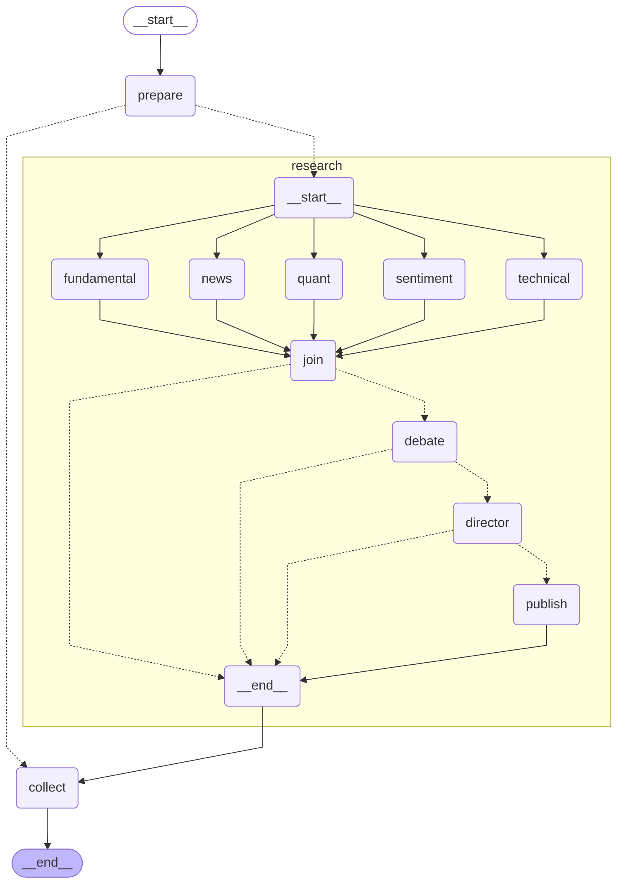

# Orchestration: the fund graph (Stage 28)

The fund runs as a [LangGraph](https://langchain-ai.github.io/langgraph/) graph (spec §11). Stage 28 builds the plumbing and proves it with deterministic stub agents: a typed fund state, one research subgraph per queued symbol fanned out in parallel, a concurrency limit, SQLite checkpoints with resume, and an error policy that drops a failing symbol for the day. The full Fund Day (spec §5) is Stage 55. Code: `src/atlas/orchestration/`.

## State (`state.py`)

`FundState` is a `TypedDict` with the fund-level keys: `as_of`, `regime`, `macro_outlook`, `research_queue`, `reports` (symbol → analyst → `AnalystReport`), `theses` (symbol → `InvestmentThesis`), `proposals` (pod → `PodProposal`), `allocation`, `target`, `risk_decision`, `compliance`, `orders`, `errors` (`NodeError`s).

- Fields that parallel nodes write have reducers: `reports` (`merge_reports`), `theses` and `proposals` (`merge_keyed`), `errors` (`append_errors`). They never mutate their inputs and give the same result in any order. Writing an equal value twice is fine; writing a **different** value under a key that has one raises `OrchestrationError` (two nodes disagreeing is a bug, not a merge).
- Every other field has one writer. Two parallel writes to it make LangGraph raise `InvalidUpdateError`.
- Sequences are lists: a checkpoint turns a top-level tuple into a list, so a resumed state would not equal an uninterrupted one.

`ResearchState` is one symbol's subgraph state (`symbol`, `as_of`, `analyst_reports`, `debate`, `thesis`, plus the output fields); `ResearchInput` is what the fund graph sends it and `ResearchOutput` what it hands back (`reports`, `theses`, `errors`).

## Research subgraph and fan-out (`research_graph.py`)

Agents plug in through a `ResearchTeam`: `analysts` (name → `AnalystFn`), `debate` (`DebateFn`) and `director` (`DirectorFn`), plain callables that take a `ResearchTask(symbol, as_of)`. Stage 28 uses `stub_team()` (`stubs.py`: the five analysts of spec §6, outputs fixed by BLAKE2b hashes of the task); Stages 29–34 wrap `BaseAgent.run` into the same slots.

- **One symbol** (`build_research_subgraph`): every analyst starts at once; `join` waits for all of them; then `debate`, `director` and `publish`. Only `publish` writes the symbol's `reports` and `theses`. The debate, the director and the fund state see the reports in the team's **roster order**, never in the order LangGraph merged the parallel writes (prompts must not depend on thread timing). Outputs are checked: the right contract type, `ticker`, `as_of` and analyst name, or a `DataError`.
- **The day** (`build_research_graph(team, max_concurrency=...)`): `prepare` checks `as_of` (a `date`) and the symbols and de-duplicates the queue; one LangGraph `Send` per symbol starts a research subgraph, all in one step; `collect` joins them and logs `orchestration_research_done` (queued, researched, dropped). An empty queue goes straight to `collect`.
- **Concurrency** (`orchestration.max_concurrency` in `config/fund.yaml`, default 4): at most that many agent calls run at once in the whole graph (a semaphore held only around each call) and at most that many symbols are in flight (LangGraph's own `max_concurrency`, which it applies per graph loop and passes down to subgraphs, so on its own it would allow N symbols × N analysts).

Agents in the analyst slots run on worker threads and may share the day's `DataView`: a view's cache and readers are thread-safe (each result computed once). `tests/integration/test_phase3_run.py` runs real `BaseAgent`s in the graph with the LLM cache, memory, traces and audit log, interrupts and resumes the run, and replays it with no provider.

## Error policy (`errors.py`)

Every agent node runs through `guarded(node, work, limiter=...)`:

- an `Exception` from the agent (including `LookAheadError` and `BudgetExceeded`) becomes a `NodeError{node, symbol, as_of, kind, message}` in `errors` and is logged (`orchestration_node_failed`, error level, with the traceback). After `join`, `debate` and `director` the subgraph ends early when the symbol has an error, so the symbol is **dropped** for the day: none of its reports and no thesis reach the fund state (fail safe, spec §3.6). Other symbols are not affected; their siblings' work goes on. `failed_symbols(errors)` lists the dropped symbols;
- `KeyboardInterrupt`, `SystemExit` and other `BaseException`s stop the run, which can then be resumed;
- LangGraph's control-flow exceptions (`GraphBubbleUp`) pass through.

## Checkpoints and resume (`checkpoint.py`)

`run_graph(graph, inputs, run_id=..., lake_path=cfg.data.lake_path)` runs a graph with a SQLite checkpointer at `<lake>/runs/<run_id>/checkpoints.sqlite` (LangGraph `thread_id` = `run_id`, a 26-char ULID). Checkpoints are written step by step (`durability="sync"`) and each finished task's writes are saved as it finishes. If the run fails or its process is killed, `resume_graph(graph, run_id=..., lake_path=...)` continues from the last checkpoint and re-runs only the unfinished work (finished symbols, and finished analysts of an unfinished symbol, are not called again); the graph must be built the same way. `run_graph` checks the inputs before it writes anything (a malformed input never leaves a checkpoint behind) and refuses a run id that already has a checkpoint; `resume_graph` refuses one without, and one started with a graph built differently: every checkpoint carries the graph's fingerprint (`ResearchGraph.fingerprint`, a SHA-256 of its structure: node names, edges, analyst roster; not the concurrency limit) as metadata. The fingerprint is computed from LangGraph's own export, so a LangGraph upgrade that changes it also refuses runs started before the upgrade (finish them first). Call both inside the run's `run_context` with the same `run_id`: logs and agent traces take their `run_id` from the run context, so a run context of another run is refused. Resuming a finished run returns its final state without calling any agent.

**No tracing.** LangGraph comes with LangSmith, which uploads every run (state and, later, prompts) to an outside service when the environment sets `LANGSMITH_TRACING=true`. Every Atlas entry point (`ResearchGraph.invoke`, `run_graph`, `resume_graph`) runs the graph through `invoke_untraced`, which turns tracing off whatever the environment says. Code that invokes a compiled graph itself must do the same.

The serializer (`serializer()`) may rebuild only the types `state_types()` lists, i.e. every model and enum a state can hold. LangGraph does not raise for another type: it hands it back as a plain dict, so a new state field must use types reachable from the state schemas.

## Diagram

The fund graph with the research subgraph expanded, as exported by `ResearchGraph.mermaid()` for `stub_team()` (a test keeps this block equal to the export; after changing the graph, paste the output of `uv run python -c "from atlas.orchestration import build_research_graph, stub_team; print(build_research_graph(stub_team(), max_concurrency=4).mermaid())"`). Dashed edges are conditional: the `Send` fan-out from `prepare`, and the routers that end a failed symbol's subgraph early.

